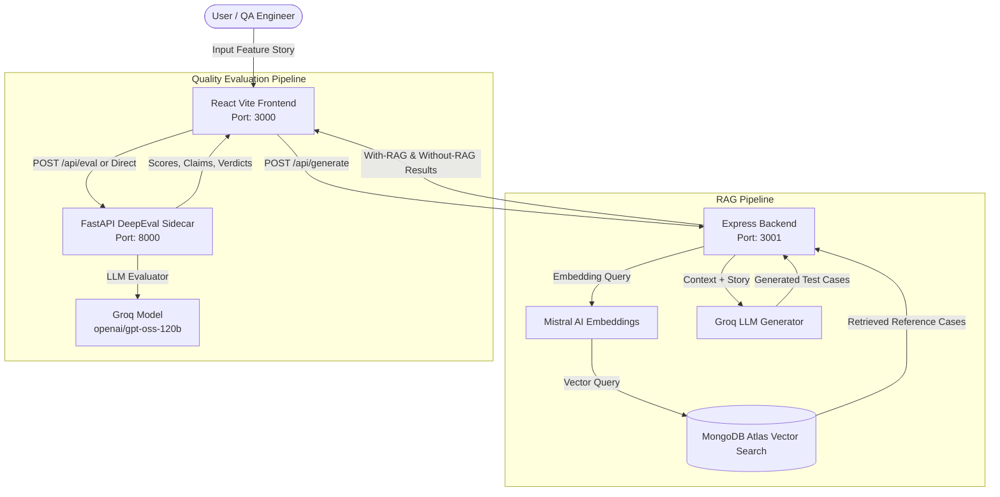

# 🧪 Enterprise RAG Test Case Generator with DeepEval Quality Pipeline

An enterprise-grade, full-stack application that leverages **MongoDB Atlas Vector Search** for Retrieval-Augmented Generation (RAG) to generate grounded test cases, coupled with an automated **DeepEval Evaluation Pipeline** to score and validate test quality across 8 key LLM metrics.

---

## 🌟 Key Highlights

- **MongoDB Atlas Vector Search**: Queries historical test repositories to retrieve relevant regression and reference test cases.
- **Side-by-Side Comparison**: Generates and compares **With-RAG** vs **Without-RAG** test cases to demonstrate domain grounding and reduction in hallucinations.
- **Automated DeepEval Evaluation**: Python FastAPI sidecar evaluating Faithfulness, Answer Relevancy, Contextual Precision, Contextual Recall, Hallucination, Bias, PII Leakage, and RAGAS.
- **Enterprise UI**: Modern, glassmorphic React interface featuring interactive test case tables, token optimization monitors, and DeepEval KPI scorecards.
- **Single-Command Launch**: Concurrently orchestrates the Express backend, Vite React frontend, and FastAPI DeepEval server with `npm run dev`.

---

## 📐 Architecture & Data Flow



---

## 📋 Prerequisites

Ensure your development environment meets the following requirements:

| Component | Minimum Version | Recommended Version | Purpose |
| :--- | :--- | :--- | :--- |
| **Node.js** | `v18.0.0+` | `v20.x` or `v22.x` | Express backend & Vite frontend runtime |
| **npm** | `v9.0.0+` | `v10.x+` | Package manager & script runner |
| **Python** | `v3.10+` | `v3.12` | FastAPI sidecar & DeepEval evaluator |
| **pip** | `v23.0+` | Latest | Python package manager |
| **MongoDB Atlas** | Cluster with Vector Search | Vector search index configured on test case collection |
| **Groq API Key** | Active account | High-speed LLM inference for generation & evaluation |
| **Mistral API Key**| Active account | Generating text embeddings for vector retrieval |

---

## ⚙️ Environment Configuration (`.env`)

Create a `.env` file in the root directory:

```bash
cp .env.example .env
```

Ensure the following variables are configured:

```env
# ===================================================
# SERVER & NETWORK PORTS
# ===================================================
PORT=3001
DEEPEVAL_PORT=8000
DEEPEVAL_URL="http://localhost:8000/eval"

# ===================================================
# DEEPEVAL EVALUATION CONFIGURATION
# ===================================================
# Recommended Groq model for fast and accurate evaluation
EVAL_MODEL="openai/gpt-oss-120b"
ENABLED_METRICS=faithfulness,contextual_precision,contextual_recall,answer_relevancy,hallucination,bias,pii_leakage,ragas

# ===================================================
# LLM & EMBEDDING API KEYS
# ===================================================
GROQ_API_KEY="gsk_your_groq_api_key_here"
MISTRAL_API_KEY="your_mistral_api_key_here"
OPENAI_API_KEY=""  # Optional fallback

# ===================================================
# MONGODB ATLAS VECTOR SEARCH
# ===================================================
MONGO_URI="mongodb+srv://<username>:<password>@cluster.mongodb.net/?retryWrites=true&w=majority"
MONGO_DB_NAME="rag_demo"
MONGO_COLLECTION_NAME="testcases"
VECTOR_INDEX_NAME="vector_index"
```

---

## 🗂️ Local Data Files

For privacy, the public repository excludes source spreadsheets in `src/data/` and generated search indexes in `src/config/`. Supply your own datasets and create the indexes locally before running data ingestion or search workflows.

---

## 📦 Installation

Install both Node.js packages and Python packages with a **single command** from the project root:

```bash
npm install
```

> [!NOTE]
> The root `postinstall` script automatically executes:
> 1. `cd client && npm install` (installs frontend packages)
> 2. `npm run install-python-deps` (runs [`scripts/install-python-deps.js`](file:///scripts/install-python-deps.js) to install FastAPI, Uvicorn, and DeepEval)

### Manual Python Dependency Install (Optional)
If you ever want to re-install or update Python packages directly:
```bash
npm run install-python-deps
```

---

## 🚀 Running the Application

Launch all three services simultaneously with:

```bash
npm run dev
```

This single command concurrently starts:
1. **Frontend (Vite + React)**: [http://localhost:3000](http://localhost:3000)
2. **Backend API (Node.js + Express)**: [http://localhost:3001/api](http://localhost:3001/api)
3. **DeepEval Sidecar (Python FastAPI)**: [http://localhost:8000](http://localhost:8000) *(Interactive Swagger docs at `http://localhost:8000/docs`)*

---

## 🎯 Step-by-Step Client Demo Script (10-Minute Walkthrough)

Use this structured walkthrough to deliver an impactful client presentation:

### Phase 1: Architecture & Service Readiness (1 Min)
1. Open the browser to **[http://localhost:3000](http://localhost:3000)**.
2. Note the **DeepEval Service Connected** badge (showing green `Connected (8000)`).
3. Briefly mention the three-tier microservice architecture: React UI ⇄ Express API ⇄ FastAPI DeepEval Sidecar.

### Phase 2: RAG-Driven Test Case Generation (3 Mins)
1. In the input area, enter or paste a business user story (e.g., *"Salesforce user login troubleshooting and password reset flow"*).
2. Click **Generate Test Cases**.
3. Point out the real-time execution steps:
   - Embedding query generated via Mistral.
   - Vector search retrieving historical regression test cases from MongoDB Atlas.
   - Context assembled with strict token budgeting (8k token limit).
   - Structured JSON test cases generated via Groq LLM.

### Phase 3: With-RAG vs Without-RAG Comparison (2 Mins)
1. Switch to **Tab 2 (Comparison & Test Cases)**.
2. Show the difference:
   - **With-RAG**: Test cases follow existing enterprise standards, terminology, and cover documented edge cases retrieved from MongoDB.
   - **Without-RAG**: Test cases are generic and miss organization-specific validation steps.
3. Show the interactive **Test Case Table** with Preconditions, Steps, and Expected Results.
4. Highlight the dedicated **Evaluate (DeepEval)** button on each test case row.

### Phase 4: Automated Quality Evaluation with DeepEval (3 Mins)
1. Click **Evaluate Quality (DeepEval)** on a test case or switch directly to **Tab 4 (DeepEval Evaluation)**.
2. Show the **Metric Selection** checklist:
   - Check *Faithfulness*, *Answer Relevancy*, *Hallucination*, and *Contextual Precision*.
3. Show the **Test Case Selection Dropdown**:
   - Highlight that you can evaluate **Reference / Regression Test Cases** (directly from MongoDB) or **Newly Generated Test Cases** (With-RAG vs Without-RAG).
4. Click **Run Evaluation**:
   - Show how the FastAPI server executes DeepEval metrics in seconds using `openai/gpt-oss-120b`.
5. Review the Results:
   - **KPI Summary Cards**: Average Score (e.g. `98%`), Passing Count, Overall Verdict (`PASSED`).
   - **Detailed Metric Cards**:
     - **Faithfulness**: Shows exact truths extracted vs claims made with zero contradictions.
     - **Answer Relevancy**: Confirms alignment with the original user story.
     - **Hallucination**: Displays inverted safety score (0 contradictions = 100% factual).

### Phase 5: Enterprise Settings & Customization (1 Min)
1. Click the **Settings (⚙️)** icon in the top header.
2. Navigate to the **DeepEval Service** tab.
3. Show configurable parameters:
   - DeepEval Server URL & Port.
   - Evaluation Model (`openai/gpt-oss-120b`).
   - Enabled Metrics toggles.
4. Click **Ping Service** to demonstrate real-time health monitoring.

---

## 📊 DeepEval Metrics Reference

| Metric | What It Measures | Target Score |
| :--- | :--- | :--- |
| **Faithfulness** | Validates if every claim in the test case is supported by the retrieved context. | `≥ 0.8` (80%) |
| **Answer Relevancy** | Ensures test steps and assertions directly address the user story requirement. | `≥ 0.8` (80%) |
| **Contextual Precision** | Determines whether the most relevant MongoDB context chunks were ranked first. | `≥ 0.7` (70%) |
| **Contextual Recall** | Measures if all necessary context needed to generate the test case was retrieved. | `≥ 0.7` (70%) |
| **Hallucination** | Detects unsupported facts or fictitious preconditions/steps. | `0.0` (Inverted to 100% in UI) |
| **Bias** | Checks for discriminatory language or gender/role bias in test scenarios. | `0.0` (Low bias) |
| **PII Leakage** | Verifies that no sensitive personal data (emails, SSNs, phone numbers) is leaked. | `0.0` (Zero leakage) |
| **RAGAS** | Holistic multi-metric RAG score comparing actual output to reference answers. | `≥ 0.8` (80%) |

---

## 🛠️ Project Structure

```
rag-mongo-demo-v14/
├── client/                             # React Vite Frontend (Port 3000)
│   ├── src/
│   │   ├── components/
│   │   │   ├── processing/
│   │   │   │   └── PromptSchemaManager.js # Main UI, Comparison, & DeepEval Tab
│   │   │   └── settings/
│   │   │       └── Settings.js            # Settings modal with DeepEval tab
│   │   └── App.js
│   ├── vite.config.js                  # Vite configuration & API proxy
│   └── package.json
├── server/                             # Express Node.js Backend (Port 3001)
│   └── index.js                        # Vector search, RAG logic & /api/eval proxy
├── llm-eval-providers/                 # Python DeepEval Microservice (Port 8000)
│   ├── deepeval_server.py              # FastAPI server implementing 8 metrics
│   └── requirements.txt                # Python dependencies
├── scripts/
│   ├── install-python-deps.js          # Cross-platform pip installer
│   └── run-python-server.js            # Python server launcher
├── .env.example                        # Environment variables template
├── package.json                        # Root npm orchestrator
└── README.md                           # Documentation & Client Demo Guide
```

---

## 🔧 Useful Commands

| Command | Action |
| :--- | :--- |
| `npm run dev` | Starts Backend (3001), Frontend (3000), and DeepEval (8000) concurrently |
| `npm run build` | Builds the React production bundle in `client/build` |
| `npm run install-python-deps` | Re-installs Python packages for the DeepEval service |
| `npm run python-server` | Starts only the Python DeepEval FastAPI service |
| `npm run server` | Starts only the Express Node.js backend |
| `npm run client` | Starts only the React Vite dev server |

---

## ❓ Troubleshooting & FAQs

### Port Conflict (Port 3000, 3001, or 8000 in use)
- The Express server automatically attempts to reclaim port 3001 if left busy by an old process.
- If port 3000 is occupied, Vite will automatically select the next available port.
- To inspect or kill any lingering process on Windows PowerShell:
  ```powershell
  Get-NetTCPConnection -LocalPort 3000, 3001, 8000 | Select-Object LocalPort, State, OwningProcess
  Stop-Process -Id <PID> -Force
  ```

### DeepEval Health Check Fails
- Test the health endpoint directly:
  ```bash
  curl http://localhost:8000/health
  # Or via Express proxy:
  curl http://localhost:3001/api/eval/health
  ```
- If offline, ensure Python is installed and run `npm run python-server` to inspect any Python errors.

### Groq Model Configuration
- We recommend `openai/gpt-oss-120b` in `.env` (`EVAL_MODEL="openai/gpt-oss-120b"`).
- Groq models require the exact identifier prefix configured in `.env`.
